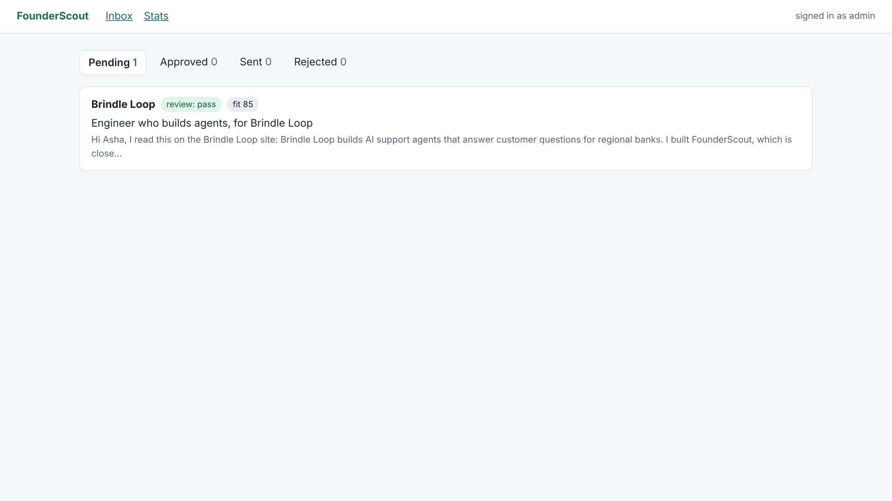
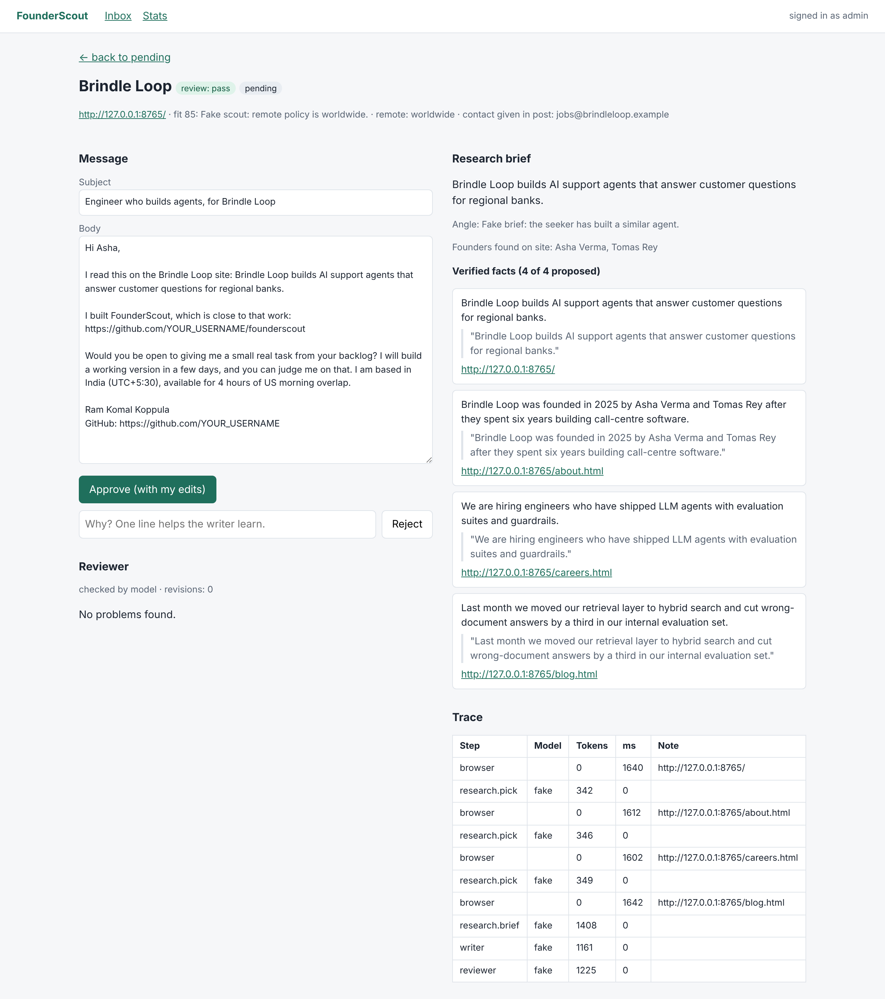

# FounderScout


An agent that runs my job search. Every morning it finds startups hiring for AI
roles, reads each company's website in a real browser, writes a short message to
the founders, has a second model fact-check that message, and puts it in an inbox.
Nothing leaves the inbox until I approve it.

**Live inbox (read-only login):** ADD_YOUR_RENDER_URL · user `viewer`, password `ADD_VIEWER_PASSWORD`
The server is on a free plan and sleeps when idle, so the first load takes about a minute.



One draft: the message on the left, the verified facts (each with its exact quote and source page) and the full trace on the right.



## How it works

```
GitHub Actions (07:00 IST, daily)
        |
        v
  Scout ----------> reads "Who is hiring" posts, scores fit, skips what I have seen
        |
        v   one company at a time, as a LangGraph state machine
  Research -------> browses the company site (Playwright), the model picks each next page
        |           every fact must carry an exact quote; code checks the quote is on the page
        v
  Writer ---------> drafts a message from verified facts + lessons from my past edits
        |   ^
        v   | revise (max 2)
  Reviewer -------> rule checks in Python, then a model from a different provider
        |
        v
  Postgres (Neon) <----- Approval inbox (FastAPI on Render): approve, edit or reject
```

## What makes it more than a script

| Idea | Where | Why it matters |
|---|---|---|
| The model chooses its own next action | `agents/research.py` | It decides which page to open from what it just read, inside a hard page budget |
| Quote-verified facts | `agents/research.py` | A fact survives only if its quote is really on the page, so invented facts die early |
| Independent reviewer | `agents/reviewer.py` | Cheap rules first, then a second provider's model compares the draft with the facts |
| Human approval | `web/app.py` | The agent cannot send anything. A person decides every time |
| Memory | `memory.py`, `db.py` | It never researches a company twice, and it turns my edits into rules for the writer |
| Full trace | `trace.py` | Every model call and page visit is stored with tokens and time |
| Structured output with repair | `llm.py`, `schemas.py` | Every model answer is validated with Pydantic; on failure the error goes back to the model once |
| Polite browsing | `browser.py` | Obeys robots.txt, honest User-Agent, rate limited, read-only, no private addresses (SSRF guard) |

## Tests

24 automated tests run on every push (fake model + a local test website, no API keys needed).
They force failures on purpose: a writer that invents a funding round must be sent back by
the reviewer, a fact with an invented quote must be dropped, the browser must refuse a page
blocked by robots.txt, the viewer login must not be able to approve, and a form on another
site must not be able to press the approve button.

## Results

**Reviewer eval** (`python -m evals.reviewer_eval`): six kinds of error are planted in
correct drafts, and the reviewer must flag them.

<!-- Replace this block with the output of a REAL run (LLM_MODE=real), then with --from-db
     once you have approved 10+ drafts. Never publish a number a command here cannot reproduce. -->
Mechanism check with the built-in fake model (rules plus a one-trick fake reviewer):
catch rate 12 of 18, false alarms 0 of 3. The three rule-checked errors (wrong company name,
placeholder, unknown link) are caught every time; invented customers and invented claims about
the sender need the real reviewer model. Real-model numbers: ADD_AFTER_FIRST_REAL_EVAL.

**Live numbers** (`python -m founderscout.metrics`): ADD_AFTER_A_WEEK_OF_REAL_RUNS

**Research accuracy** (`python -m evals.research_eval`): facts are checked by hand. ADD_AFTER_LABELLING

### What does not work well yet

- Sites that block bots cannot be researched; the company is marked failed and skipped.
- The quote check proves a quote is on the page, not that the claim means the same thing.
  That is why there is a reviewer, a human, and a hand-labelled eval.

## Run it yourself

```bash
git clone https://github.com/YOUR_USERNAME/founderscout && cd founderscout
python -m venv .venv && source .venv/bin/activate      # Windows: .venv\Scripts\activate
pip install -r requirements.txt
python -m playwright install chromium
cp .env.example .env                                   # Windows: copy .env.example .env

# No API keys needed for this part: a fake model and a local test site.
python -m http.server 8765 --directory tests/fixtures/site     # terminal 1
python -m founderscout.run --source file                       # terminal 2
uvicorn founderscout.web.app:app --reload                      # open http://127.0.0.1:8000 (admin / dev)
python -m pytest
```

For real runs, put free Gemini and Groq keys in `.env`, set `LLM_MODE=real`, fill in
`my_profile.json`, then `python -m founderscout.run --max 2`.

## Stack

Python · LangGraph · Playwright · FastAPI · SQLAlchemy · Postgres (Neon) · Gemini + Groq
through the OpenAI-compatible API · GitHub Actions · Render. Total running cost: zero.

## Rules the agent follows

It reads public pages only, obeys robots.txt, identifies itself, never logs in anywhere,
never submits forms and never sends a message. I read and send every message myself.
